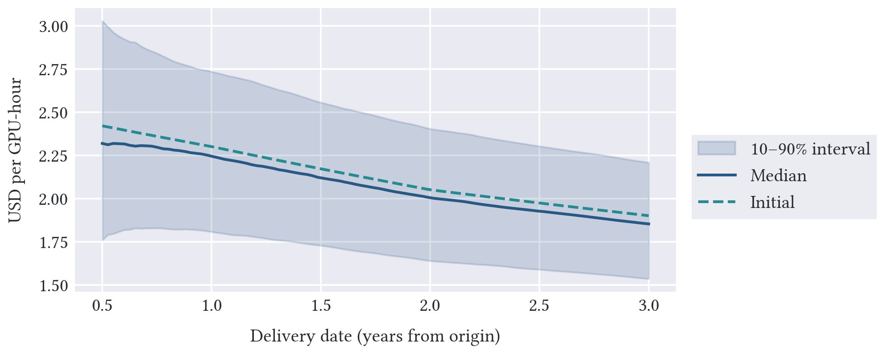
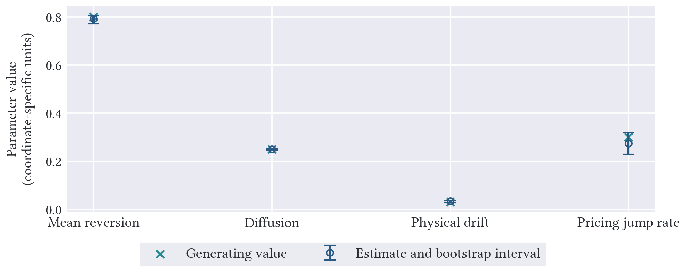
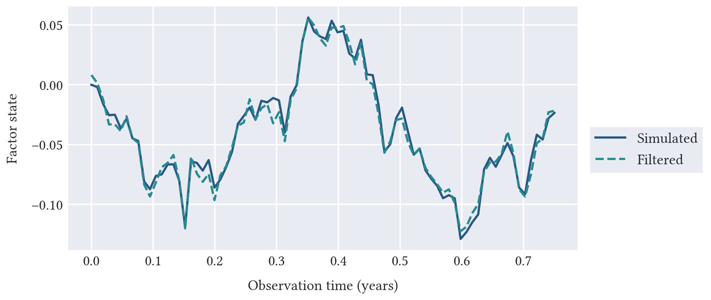
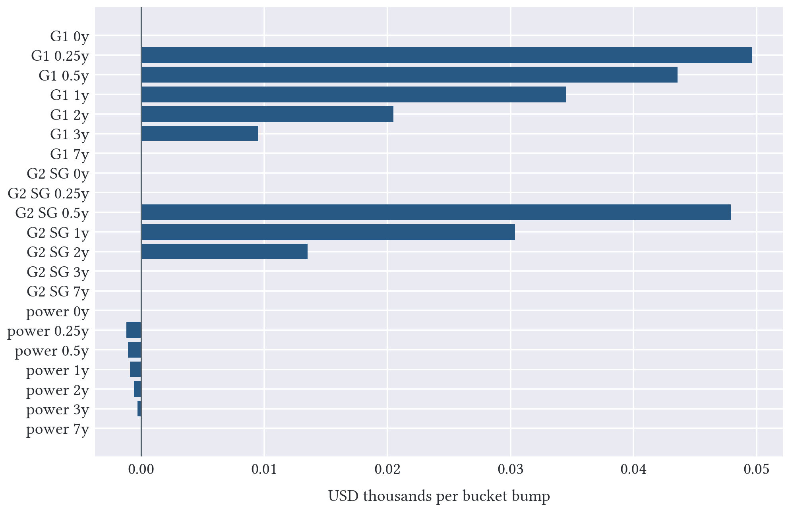
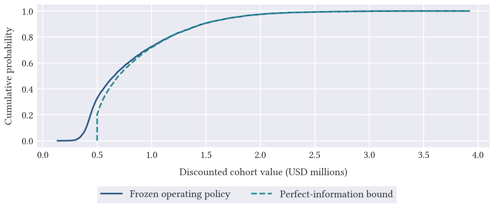
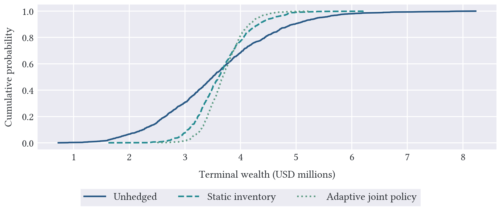
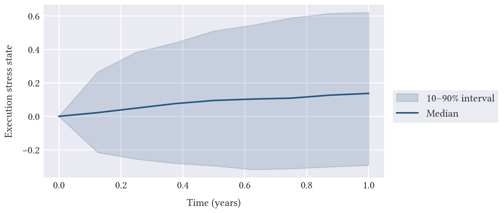
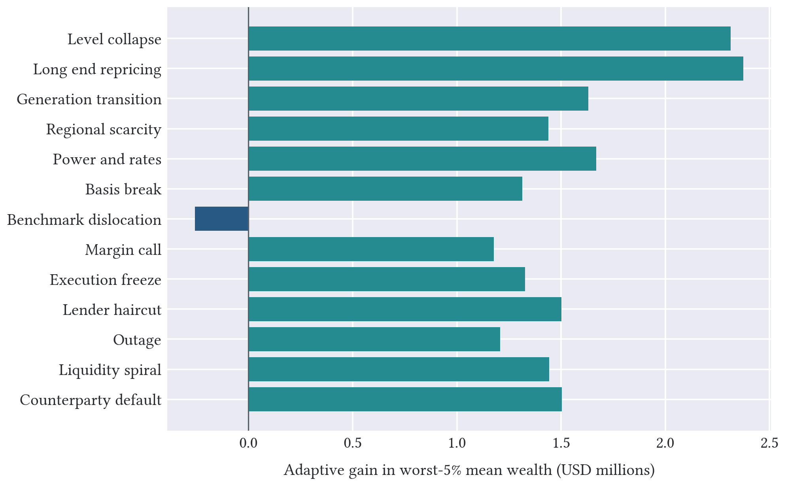
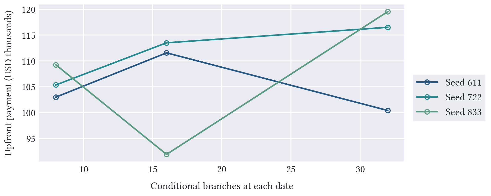

# Research design

A compute provider accepting a new contract commits capacity while taking on delivery, power and financing obligations. Its reservation price is the payment that preserves the optimized value of its existing book after these obligations are added. The experiments examine how operating flexibility and financial hedging affect this value, and how the cash needed to carry a hedge limits the protection it provides.

A shared curve model links compute benchmarks and basis, power, rates and funding. Through this common state, a market shock can change physical delivery costs, hardware appraisal and the value of financial claims, while also changing the operator's preferred dispatch and financing decisions. Execution liquidity responds to both idiosyncratic shocks and shared funding shocks.

All inputs are synthetic. The portfolio experiment trains on 4,096 paths, evaluates 1,024 independent paths, and uses 256 conditional innovations per decision. Thirteen named stresses use 512 paths each. The horizon is one year with eight operating intervals. Each policy faces the same market, physical, liquidity and counterparty events on each evaluation path.

The financial universe has eleven dated futures, two paid puts, a transferable fixed-strike power forward and a periodic compute cap. The adaptive policy observes the simulated factors in full and jointly chooses dispatch, financing and financial positions using a fitted continuation value for a specified future operating plan. Separate experiments examine what can be learned from noisy prices, how delivery exposure extends beyond the factor model, and how operating choices and financing enter asset values and reservation prices on finite scenario trees.

# Pricing consistency

The portfolio calculations require consistent futures marks, discounting and option values under the shared pricing law. Its cumulant normalizes the positive futures curves; the electricity reference is additive. Across 65,536 pricing-law paths, the twelve market/date checks depart from the futures martingale identity by at most 2.42 Monte Carlo standard errors. The two-year analytical discount factor is 0.92890389, versus 0.92886497 in simulation with standard error 0.00003815.

The two-year G1 futures reference is 2.050000; the corresponding terminal-forward strike is 2.050820. Rate–compute covariance generates this difference; setting the rate loading to zero removes it. Splitting and recombining an arithmetic delivery strip changes its mark by 4.4e-16.

Option prices are calculated from the discounted affine transform. Doubling Fourier quadrature from 128 to 256 nodes changes the three tested put prices by at most 1.2e-14. Independent pricing-law Monte Carlo, Gaussian-limit formulas, put–call parity and expiry settlement provide separate checks. Deterministic option prices allow the operating controller to compare funded protection with futures without simulation noise from option valuation at each decision.

# Estimating the curve and its dynamics

Calibration separates the delivery curve observed today from the parameters governing its evolution. The initial-curve fit recovers eight knots from dated and strip observations. Its data Jacobian has rank 8, with weighted quote RMSE 0.387 in measurement-standard-error units.

To examine identification of the dynamics, the structural recovery experiment uses a two-factor affine model, 4,096 independent physical histories, 24 transitions per history and nine noisy option prices. Four parameters are estimated while nuisance jump parameters and loading anchors remain fixed. Six option prices at excluded expiries are reserved for checking the fitted model. This controlled identification test is separate from the nine-factor operating study, whose physical drift is fitted from its own training sample.

| Free coordinate | Generating value | Estimate | Bootstrap 2.5–97.5% |
|---|---:|---:|---:|
| level mean reversion | 0.80000 | 0.79301 | 0.77156–0.80616 |
| level diffusion | 0.25000 | 0.24972 | 0.24722–0.25141 |
| physical level drift | 0.03000 | 0.03265 | 0.02784–0.03613 |
| pricing jump intensity | 0.30000 | 0.27375 | 0.22896–0.31822 |

All 24 of 24 cluster-bootstrap refits converged, and the data-only Jacobian has full rank 4. Held-out option-price RMSE is 0.000569 per quoted unit. In a separate example, estimating physical drift from a time-zero futures reference alone gives data rank 0, even with a prior penalty.

Process variation, averaged across bootstrap fits, contributes 0.278340 to estimated predictive variance; variation in the predicted means contributes 0.000048. This balance reflects the large synthetic sample; a short market history can leave substantially more parameter uncertainty.

# What a short price history identifies

The preceding recovery experiment pools many independent histories. To examine what a single short history reveals, a separate experiment observes three clean prices, each with measurement noise, at 145 dates over three years. It estimates one physical drift coordinate with the remaining law fixed. The fitted drift is -0.1203, against the generating value 0.0300, while the two factor-state RMSEs are 0.0092 and 0.0229.

The quasi-likelihood profile is nearly flat: over the entire tested range from −0.20 to +0.20, twice the objective change stays below 3.21. The short history gives more precise estimates of the factor states than of long-run drift. This profile measures sensitivity with nuisance coordinates fixed; finite-sample coverage would require a design-specific bootstrap.

Filtering is also examined in the nine-factor model, using fifteen prices per date to predict two withheld local prices. The held-out quote RMSE is 0.0094 per GPU-hour and the minimum observation rank is 8 of nine. These results describe inference from noisy observations; the portfolio policies below use fully observed simulated factors.

# Delivery exposure and risk outside the factor model

A delivery curve can move in ways that the chosen factors do not represent. To measure this exposure, a clean physical-margin strip is perturbed in 21 calendar-delivery buckets across two compute references and one power reference. Compute buckets use log coordinates; power buckets use price coordinates. Their Jacobian with respect to the factors has rank 8 of nine. For claims supported on the chosen delivery nodes, sensitivities mapped from delivery buckets differ from analytic factor Greeks by at most 0.0042 currency per factor unit, against sensitivities on the scale of millions of dollars. Half-size bumps change a bucket delta by at most 0.00062.

A constructed bucket shock has factor-projection norm 2.2e-16, yet produces P&L of 4,648.82 when the portfolio is revalued. The local bucket estimate is 4,634.73. This exposure arises from a curve movement outside the affine factor span. The shock is a sensitivity test with no assigned occurrence probability.

For a financed portfolio, the response to a curve change also depends on the decisions it induces. We therefore reoptimize after perturbing the G1 US initial curve, using the same conditional innovations for every perturbation. This calculation has three branches and two intervals, so the reported policy response is specific to that finite scenario tree.

| Delivery center | P&L for a 0.0001 log bump | Delta change after half bump |
|---|---:|---:|
| 0.5 years | 34.08 | -0.0006 |
| 1 years | 41.62 | -0.0004 |
| 3 years | 10.92 | 0.0000 |

These sensitivities serve different purposes in hedging. A covariance-weighted projection selects a hedge against factor exposure, while the bucket-shape projection measures how much delivery-curve risk lies outside the factor model. The full financial universe spans 7 local covariance directions. The constrained hedge respects signed position limits, turnover limits and a 430,000 cash budget. Full conditional revaluation also includes nonlinear jump and funding risks.

# The value of operating flexibility

Hardware value depends on the owner's ability to change how it is used as margins evolve. The asset experiment values this flexibility for a 64-GPU cohort over three years, using 24 operating intervals. It includes startup and shutdown costs, standby expenses, two-interval minimum runs and an independent retirement-sale function. The interval rental rate is fixed when operating capacity is committed. The policy trains on 8,192 pricing-law paths and is evaluated on 8,192 independent paths.

\Needspace{12\baselineskip}

| Operating rule | Discounted value (USD) | Standard error (USD) |
|---|---:|---:|
| Switching and retirement | 817,178 | 5,201 |
| Always operate | 706,838 | 6,477 |
| Sell immediately | 500,000 | — |
| Perfect-information upper comparison | 863,864 | 4,871 |

The switching and retirement policy has a higher estimated value than either continuous operation or immediate sale. It operates for an average 16.26 intervals and retires on 55.5% of paths. Its mean gap to the information upper bound is 46,686, with paired standard error 924. Every policy path satisfies its operating constraints and remains below the corresponding upper payoff up to rounding.

Operating value informs investment decisions. The separate financed-fleet experiment uses different quantities and horizons from the 64-GPU experiment, with borrowing tied to lender appraisal and sales valued at executable proceeds.

# Hedging benefits and funding needs

The portfolio comparison measures protection after accounting for the cost of funding the hedge and delivering the committed service. All policies start with the same capacity, commitments, debt and cash. The worst-5% column averages terminal wealth over exactly 5% of probability mass, with fractional weight at the boundary observation. Higher mean and tail wealth are preferable; lower standard deviation indicates less dispersion.

| Policy | Mean wealth (USD m) | Worst-5% wealth (USD m) | SD (USD m) |
|---|---:|---:|---:|
| Unhedged | 3.566 | 1.578 | 1.088 |
| Static financial inventory | 3.653 | 2.708 | 0.517 |
| Adaptive joint policy | 3.704 | 3.013 | 0.362 |

Relative to the unhedged policy, adaptive control raises worst-5% mean wealth by 1,434,742, with a paired bootstrap interval of 1,309,347–1,553,503. Mean wealth rises by 137,476 and standard deviation falls by 66.8%. It also raises worst-5% mean wealth by 304,865 relative to static inventory. The bootstrap intervals measure sampling uncertainty under this synthetic market law.

The operator must deliver 350,400 GPU-hours of firm service on each path over the year. Delivery shortfall includes service left unfulfilled after financing failure.

| Policy | Mean shortfall (GPU-hours) | Share of promised service |
|---|---:|---:|
| Unhedged | 38.88 | 0.0111% |
| Static financial inventory | 38.88 | 0.0111% |
| Adaptive joint policy | 38.88 | 0.0111% |

The policies have the same mean delivery shortfall in this experiment, but their cash requirements differ. Initial margin is recorded after every trade and returned at settlement. Average posted margin weights each balance by the time it remains posted. Peak margin is the maximum requirement along a path; the table reports its 95th percentile across paths. Borrowing interest, debt fees, premiums and trading costs enter terminal wealth.

| Policy | Average posted IM (USD m) | Peak IM, p95 (USD m) | Failed paths |
|---|---:|---:|---:|
| Unhedged | 0.000 | 0.000 | 0 / 1,024 |
| Static financial inventory | 0.352 | 0.744 | 0 / 1,024 |
| Adaptive joint policy | 0.492 | 0.952 | 0 / 1,024 |

The adaptive policy's reduction in wealth dispersion comes with more posted margin than either comparison policy. The protection therefore depends on the operator's ability to keep cash available for collateral throughout the life of the hedge.

Instrument choice also changes the balance between protection and funding. To measure what the additional instruments contribute, we evaluate the adaptive policy with only the eleven futures. The full universe adds two paid puts, a transferable power forward and a periodic cap. Both versions use the same training sample, simulated paths and conditional innovations.

Adding these four instruments raises mean wealth by 11,039 (0.30%) and worst-5% mean wealth by 41,451 (1.40%). The paired interval for the tail improvement is 23,408–61,108. Peak margin at p95 changes by -69,972, and average posted margin by -39,916. Here the additional instruments modestly improve tail wealth and reduce posted margin. Practical instrument selection also depends on access, funding terms and implementation costs.

# Liquidity, credit and stress

The funding requirements above are measured on paths that already include stochastic spreads, executable depth and collateral multipliers linked to funding conditions and market declines. Supplier defaults become known when they occur, and the cash ledger records funded positions, segregated margin, payable liabilities and default recovery. The additional stress interventions examine how the hedge performs when particular sources of market, funding or delivery risk become more severe.

\Needspace{22\baselineskip}

| Named intervention | Adaptive gain in worst-5% wealth (USD m) | Adaptive failures / 512 |
|---|---:|---:|
| Level collapse | +2.313 | 0 |
| Long end repricing | +2.375 | 0 |
| Generation transition | +1.631 | 0 |
| Regional scarcity | +1.440 | 0 |
| Power and rates | +1.668 | 0 |
| Basis break | +1.314 | 0 |
| Benchmark dislocation | -0.257 | 1 |
| Margin call | +1.177 | 9 |
| Execution freeze | +1.326 | 0 |
| Lender haircut | +1.501 | 0 |
| Outage | +1.208 | 0 |
| Liquidity spiral | +1.442 | 19 |
| Counterparty default | +1.503 | 0 |

Under benchmark dislocation, the adaptive hedge reduces worst-5% mean wealth relative to the unhedged portfolio as the hedge loses alignment with the physical book. Margin, execution and liquidity interventions examine whether the operator can finance its positions through adverse cash demands. Margin calls and liquidity spirals produce financing failures even when hedging raises worst-5% mean wealth. These failures enter both the wealth and service outcomes.

# Reservation pricing and numerical resolution

The reservation calculation prices a new obligation by comparing optimized financed-portfolio values before and after acceptance under the same curve law. It fixes two decision intervals over one year and varies the number of branches and the simulation seed to examine sensitivity to numerical resolution. Futures, European options and the fixed-strike forward have cash flows compatible with this grid. The quarterly cap is excluded because its payment dates fall between the grid dates.

| Branches | History nodes | Payment range, three seeds (USD) | Local 90% tail mass |
|---|---:|---:|---:|
| 8 | 73 | 102,998–109,244 | 0.8 |
| 16 | 273 | 91,914–113,508 | 1.6 |
| 32 | 1,057 | 100,414–119,549 | 3.2 |

Across these sampled trees, variation in reservation payments is larger than the certified interval for any one tree. With independent draws at each branch count, increasing the number of branches need not move the price monotonically toward a limit. The results also report conditional tail weights and whether the risk evaluation concentrates on the worst state.

# Accounting checks and reproducibility

The wealth and funding comparisons depend on recording each cash flow at the appropriate date. Across all portfolio cases, the largest cash-equation residual is 9.3e-10 currency units and the largest independent terminal-wealth reconstruction error is 2.8e-09. The largest numerical prefunding residual is 1e-06. Distributions, premium exchanges, debt principal, interest, transaction costs and hardware sales remain separate accounting components.

`results/study/` contains complete valuation cases and all training, holdout and stress tapes. `assets/` stores the operating rule, independent outcomes and upper comparison. `risk/` stores bucket shocks, factor bridges, financed-book bumps and transform checks. `calibration/` stores raw synthetic histories, noisy quotes, anchors, parameter draws, held-out repricing and the latent profile. `pricing/` retains complete finite programs and solver certificates.

Verification commands and the original release's validation record are in `docs/VALIDATION.md`.
